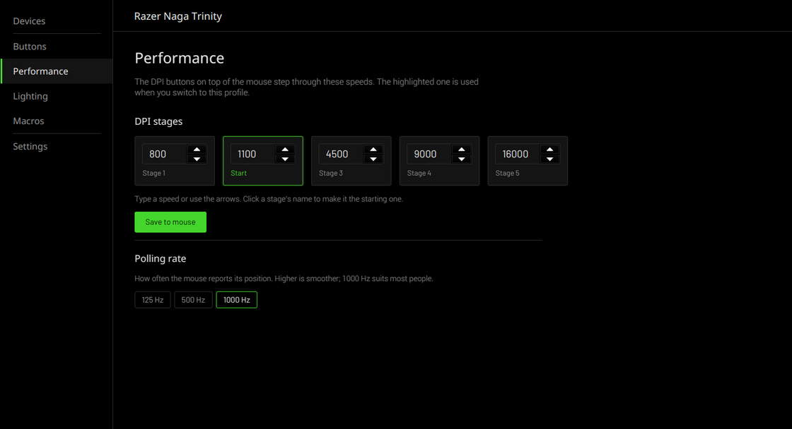
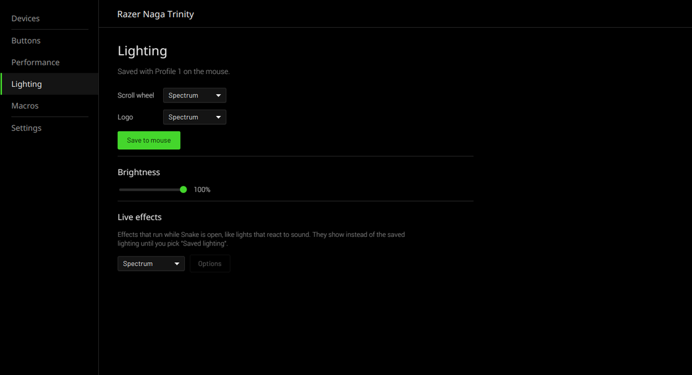
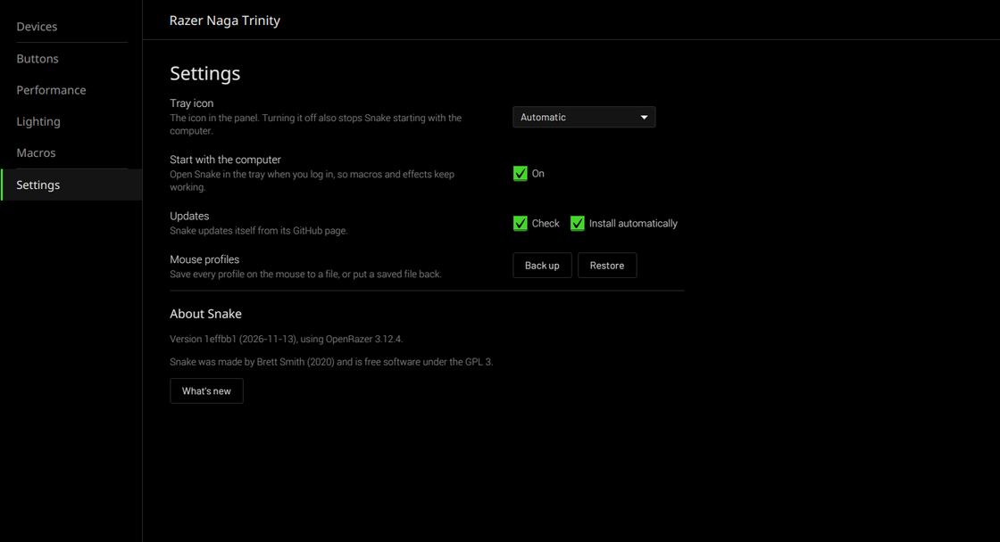

# Snake (fork)

A Linux app for Razer devices: button mapping, DPI, polling rate, lighting,
macros and the profiles stored on the mouse itself. It talks to your devices
through [OpenRazer](https://openrazer.github.io/), and to the mouse's own
memory directly.

This is a maintained fork of [Snake by Brett Smith](https://github.com/bithatch/snake),
which stopped being developed in 2021 and no longer builds or runs properly on
current Linux. This fork targets a Razer Naga Trinity on Linux Mint 22, but
should work with anything OpenRazer supports.



## What's new in this fork

- **A new look**: one window with a menu (Devices, Buttons, Performance,
  Lighting, Macros, Settings). On the Naga Trinity the Buttons page shows the
  mouse with each button labelled.
- **Profiles on the mouse**: Razer mice with onboard memory keep their
  button mapping, DPI stages and lighting in up to five profiles. Snake reads
  and saves them without Synapse, so your settings work on any computer, even
  without Snake running.
- **Macros** that press another key, type text or run a command, grouped in
  sets you can switch between.
- Software Spectrum, Breath and Audio (lights follow your sound) effects for
  mice whose driver only does a static colour.
- Builds again on Java 21 with released libraries only. It works with PipeWire,
  current AMD/Mesa graphics and desktops without bamf (Cinnamon, KDE, ...).
  Idle CPU use is close to zero.
- Tray icon works again (on Cinnamon: left click opens Snake, right click shows the menu).
- Updates come from this repository. No usage statistics are sent.

See [CHANGES.md](CHANGES.md) for details.

## Requirements

- Linux with [OpenRazer](https://openrazer.github.io/) installed and its daemon running,
  and your user in the `plugdev` group.
- Java 21 (`sudo apt install openjdk-21-jdk`)
- Maven 3.9+ (`sudo apt install maven`)
- git

## Install

```
git clone https://github.com/ScoobyDouche/snake.git ~/snake
~/snake/bin/snake
```

The first start builds Snake, which takes a minute or two. Snake adds itself to
your app menu and starts with the computer (you can turn that off in Settings).

### Profiles on the mouse

Reading and saving the mouse's own profiles needs access to its raw HID device,
which Linux only gives to root by default. The Buttons page offers a one-click
**Allow access** button that installs a udev rule for just that mouse (it asks for
your password). To do it by hand for a Naga Trinity:

```
sudo cp ~/snake/linux/70-snake-razer-0067.rules /etc/udev/rules.d/ && sudo udevadm trigger
```

Before the first save, Snake backs up every profile on the mouse to
`~/.local/share/snake/onboard-backups/`. Settings has Back up and Restore too.
Saving to mice other than the Naga Trinity is untested and stays off unless
you allow "Experimental saving" in Settings.

## Using it

- **Buttons**: click a button to change what it does (a key, a mouse button,
  DPI up/down, next profile, or off). Pick your side plate (2, 7 or 12 buttons)
  at the top. Changes are saved on the mouse.
- **Performance**: DPI stages for the DPI buttons, and the polling rate.
- **Lighting**: colours saved with each profile, brightness, and live effects
  that run while Snake is open.
- **Macros**: things that run through Snake when you press a button, so Snake
  has to be running (it stays in the tray).
- **Settings**: tray icon, start with the computer, updates, backups.
- The profile picker at the top right picks which profile you're editing.
  The button under the mouse switches between them.






## Updates

Snake checks this repository for new commits. When there is one, Settings shows
**Update now**; click it and Snake closes, pulls the update, rebuilds and
reopens. With **Install automatically** on, updates are installed whenever
Snake starts.

You can also update by hand: `git -C ~/snake pull` and start Snake again.
The launcher's log is in `~/.cache/snake/launcher.log`.

## License

GPL-3.0, same as the original. Original code copyright Brett Smith and
contributors; see [LICENSE](LICENSE) and [other-licenses](other-licenses).
The Barlow fonts are under the SIL Open Font License (see `OFL.txt` next to them).
Razer, Naga and Synapse are trademarks of Razer Inc.; this project is not
affiliated with Razer.
