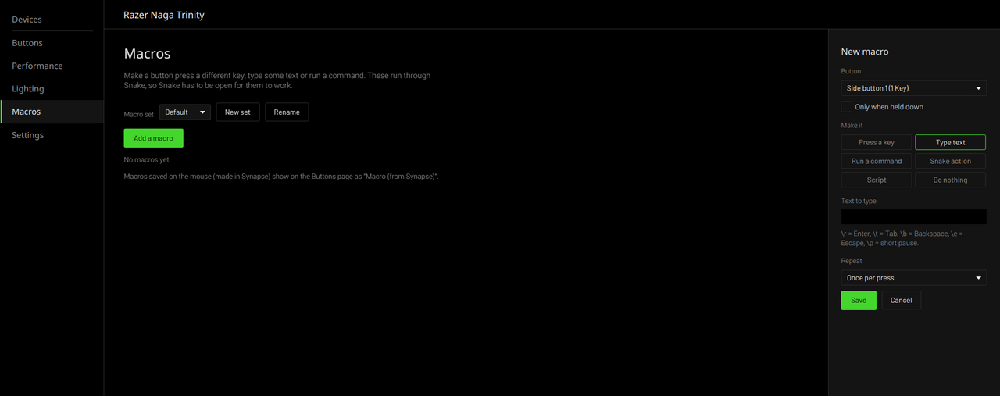

# Snake (fork)

A Linux app for Razer devices: lighting effects, brightness, DPI, polling rate,
profiles, and button mapping/macros. It talks to your devices through
[OpenRazer](https://openrazer.github.io/).

This is a maintained fork of [Snake by Brett Smith](https://github.com/bithatch/snake),
which stopped being developed in 2021 and no longer builds or runs properly on
current Linux. This fork targets a Razer Naga Trinity on Linux Mint 22, but
should work with anything OpenRazer supports.


## What this fork fixes

- Builds again: dead snapshot repositories replaced with released libraries,
  the old installer/updater removed, the macro library (macrolib) included in
  this repository.
- No more black screen when the bamf window service is missing (Cinnamon, KDE, ...).
- Works with PipeWire (sound), Java 21 and current AMD/Mesa graphics drivers.
- Idle CPU use down from about two cores to roughly zero (input-device leak on
  unplug, software rendering, a dropdown redrawing at 60fps).
- Tray icon shows again.
- Side buttons are found on devices whose layout does not list their input
  devices (Naga Trinity side plate).
- Updates come from this repository (see below).
- No usage statistics are sent.

See [CHANGES.md](CHANGES.md) for details.

## Requirements

- Linux with [OpenRazer](https://openrazer.github.io/) installed and its daemon running,
  and your user in the `plugdev` group.
- Java 21 (`sudo apt install openjdk-21-jdk`)
- Maven 3.9+ (`sudo apt install maven`)
- git

## Install

```
git clone https://github.com/ScoobyDouche/snake.git ~/snake
~/snake/bin/snake
```

The first start builds Snake, which takes a minute or two. Snake adds itself to
your app menu and to start on login (you can turn that off in Options).

## Updates

Snake checks this repository for new commits. When there is one, Options shows
**An update is available**; click it and Snake closes, pulls the update,
rebuilds and reopens. With **Update automatically** on, updates are installed
whenever Snake starts.

You can also update by hand: `git -C ~/snake pull` and start Snake again.
The launcher's log is in `~/.cache/snake/launcher.log`.

## Using it

- **Main screen**: effects, brightness, DPI, poll rate and the active
  profile/bank for each device.
- **Macros**: map device keys to other keys, mouse buttons, text, or commands.
  Each profile has banks you can switch between.
- **Design**: edit the layout image used for a device.
- **Tray icon**: keeps Snake (and your button mappings) running when the window
  is closed. Right-click it for quick controls and Quit.



## License

GPL-3.0, same as the original. Original code copyright Brett Smith and
contributors; see [LICENSE](LICENSE) and [other-licenses](other-licenses).
